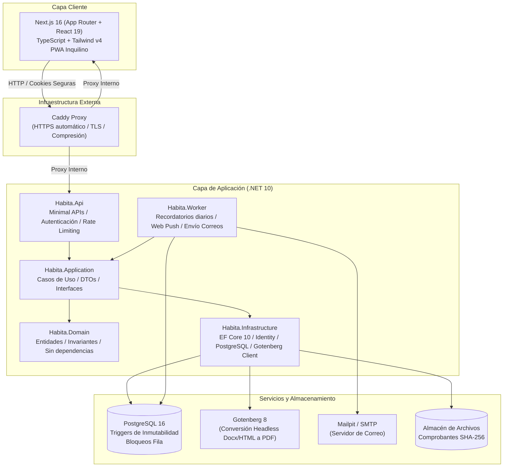

# NethRent

> **Plataforma SaaS integral para la administración de propiedades en renta con control financiero auditable, inmutable y diseñado para el mercado mexicano.**

[](https://dotnet.microsoft.com/)
[](https://nextjs.org/)
[](https://www.postgresql.org/)
[](https://tailwindcss.com/)
[](https://www.docker.com/)
[]()
[](https://playwright.dev/)

---

## 📌 Tabla de Contenidos

- [Acerca del Proyecto](#-acerca-del-proyecto)
- [Principios de Diseño y Filosofía Financiera](#-principios-de-diseño-y-filosofía-financiera)
- [Arquitectura del Sistema](#-arquitectura-del-sistema)
- [Módulos y Funcionalidades](#-módulos-y-funcionalidades)
- [Matriz de Roles y Permisos (RBAC)](#-matriz-de-roles-y-permisos-rbac)
- [Estructura del Repositorio](#-estructura-del-repositorio)
- [Arranque Rápido para Desarrollo](#-arranque-rápido-para-desarrollo)
- [Suite de Pruebas y Calidad de Código](#-suite-de-pruebas-y-calidad-de-código)
- [Despliegue y Operación en Producción](#-despliegue-y-operación-en-producción)
- [Seguridad y Protección de Datos](#-seguridad-y-protección-de-datos)
- [Documentación Adicional](#-documentación-adicional)

---

## 📖 Acerca del Proyecto

**NethRent** es una solución web y PWA diseñada para propietarios independientes y empresas administradoras de inmuebles. Su objetivo central es resolver de raíz la complejidad de la cobranza de rentas: **saber quién debe qué, registrar pagos completos y parciales con precisión milimétrica, y consultar saldos y vencimientos sin discrepancias**.

Elimina por completo la necesidad de mantener hojas de cálculo paralelas mediante un modelo contable de partida doble simplificada, no destructiva y 100% auditable.

### Características Clave:
* **Moneda e Idioma:** Español de México, moneda MXN (configurable por organización) y zonas horarias locales.
* **Multi-inquilino (Multi-tenant):** Soporte de múltiples organizaciones por usuario con aislamiento estricto por base de datos y memoria.
* **Motor de Documentos:** Generación de contratos en Word/PDF a partir de plantillas personalizadas, recibos con folios fiscales internos correlativos y estados de cuenta en PDF.
* **Operación en Campo y Portal Inquilino:** Cobro en efectivo mediante códigos QR de un solo uso escaneables por cámara, reporte de comprobantes y portal PWA instalable para inquilinos.

---

## ⚖️ Principios de Diseño y Filosofía Financiera

1. **Inmutabilidad Financiera:** Los pagos y cargos confirmados **nunca se editan ni se eliminan en silencio**. Cualquier corrección se realiza mediante reversos justificados que preservan la trazabilidad en la auditoría.
2. **Aislamiento Multi-organización por Diseño:** La identidad autenticada determina la organización activa. Filtros globales en EF Core (`Global Query Filters`), interceptores de escritura y llaves foráneas compuestas en PostgreSQL impiden cualquier fuga de información entre inquilinos.
3. **Dinero Exacto:** Cero tolerancia al redondeo inexacto por coma flotante (`float`/`double`). Todo importe monetario se maneja como `decimal` en C# y `numeric(14,2)` en PostgreSQL.
4. **La API es la Autoridad:** El frontend refleja permisos para mejorar la experiencia de usuario, pero el 100% de las reglas de negocio, transiciones de estado y validaciones de seguridad se aplican en el backend ASP.NET Core.
5. **Transacciones Atómicas e Idempotentes:** La aplicación de pagos en cascada a cargos vencidos se ejecuta en una única transacción de base de datos con bloqueo de filas para evitar duplicidades bajo concurrencia.

---

## 🏗️ Arquitectura del Sistema

El proyecto sigue los principios de **Clean Architecture** (Arquitectura Limpia) y separación estricta de responsabilidades:



### Límites Arquitectónicos Validados:
* `Habita.Domain` no tiene dependencias de ningún otro proyecto del sistema ni de bibliotecas de base de datos.
* `Habita.Application` depende exclusivamente de `Habita.Domain`.
* `Habita.Infrastructure` implementa las interfaces de persistencia y servicios externos.
* `Habita.Api` expone las Minimal APIs y gestiona la seguridad HTTP.
* Todo lo anterior es verificado automáticamente en el build mediante pruebas de arquitectura (`Habita.ArchitectureTests`).

---

## 🧩 Módulos y Funcionalidades

| Módulo | Descripción |
|---|---|
| **Propiedades y Unidades** | Gestión jerárquica de inmuebles, torres y departamentos con control de estados (*Disponible*, *Ocupado*, *Mantenimiento*). |
| **Inquilinos y Fiadores** | Expediente de inquilinos con validación y normalización de teléfonos/correos, notas y soporte de fiador legal en contratos. |
| **Contratos (Leases)** | Ciclo de vida completo (*Borrador*, *Vigente*, *Terminado*, *Cancelado*), días de vencimiento válidos (1 al 28 para evitar anomalías en meses cortos) y control de vigencias solapadas. |
| **Inventario de Entrega** | Checklist detallado de artículos y estado físico de la unidad entregada al inquilino con verificación en la entrega y devolución. |
| **Cargos y Pagos** | Generación de rentas periódicas y cargos manuales. Aplicación automática FIFO en cascada, gestión de saldos a favor (overpayments) y reversos auditables. |
| **Cobranza y Cuentas Bancarias** | Catálogo de cuentas bancarias de la organización (CLABE, banco, titular), promesas de pago con fecha límite y registro de motivos. |
| **Validación de Comprobantes** | Los inquilinos suben comprobantes de pago. Los administradores los validan en vivo con previsualización del archivo adjunto antes de aplicar el pago. |
| **Cobro en Efectivo con QR** | Cobradores en campo escanean códigos QR generados por inquilinos desde el portal. Códigos protegidos con vigencia de 4 horas y un solo uso. |
| **Motor de Documentos (PDF)** | Generación de contratos Word/PDF mediante plantillas `.docx` con tags `{{campo}}`, recibos con folios fiscales únicos sin huecos y estados de cuenta en PDF. |
| **Depósitos en Custodia** | Control contable de depósitos en garantía (no computan como ingreso ordinario). Liquidación final con descuentos (daños, adeudos) y reintegros. |
| **Importación Asistida (CSV/Excel)** | Importación masiva de inquilinos y unidades en dos fases: Previsualización validada y Confirmación protegida con hash criptográfico. |
| **Mantenimiento e Incidencias** | Reporte y seguimiento de incidencias con fotografías, prioridades y notas de resolución. Rol de mantenimiento estrictamente ciego a datos financieros. |
| **Portal del Inquilino (PWA)** | Portal móvil instalable para inquilinos: consulta de adeudos, comprobantes de pago, solicitudes de mantenimiento y QR de pago en efectivo. |
| **Notificaciones y Worker** | Tareas programadas en background: recordatorios automáticos de vencimiento por correo y Web Push (VAPID) ajustados a la hora y zona horaria local. |

---

## 👥 Matriz de Roles y Permisos (RBAC)

La plataforma aplica autorización estricta en el servidor para 7 roles diferenciados:

| Rol | Propiedades y Contratos | Cargos y Pagos | Mantenimiento | Cobro QR Campo | Usuarios y Ajustes | Portal Inquilino |
|:---|:---:|:---:|:---:|:---:|:---:|:---:|
| **Owner** | Completo | Completo | Completo | Sí | Completo (Traspaso Org) | No |
| **Admin** | Completo | Completo | Completo | Sí | Gestión de Miembros | No |
| **Finance** | Lectura | Completo | No | Sí | No | No |
| **Maintenance** | Solo Unidades | **Sin Acceso** | Completo | No | No | No |
| **Collector** | Lectura básica | Solo QR Efectivo | No | **Especialista** | No | No |
| **ReadOnly** | Lectura | Lectura | Lectura | No | No | No |
| **Tenant** | Su Contrato | Sus Pagos/Adeudos | Reportar Falla | Su QR de Pago | Solo Perfil | **Sí (PWA)** |

> 🔒 *La matriz de autorización se valida en cada compilación contra `tests/Habita.IntegrationTests/AuthorizationMatrix.txt`.*

---

## 📂 Estructura del Repositorio

```text
.
├── src/
│   ├── Habita.Domain/          # Entidades de dominio, invariantes, enums y reglas puras
│   ├── Habita.Application/     # Casos de uso, DTOs, validadores y contratos de servicio
│   ├── Habita.Infrastructure/  # EF Core, PostgreSQL, Gotenberg, Identity y Almacenamiento
│   ├── Habita.Api/             # Minimal APIs HTTP, middleware de seguridad y configuración
│   └── Habita.Worker/          # Servicio en segundo plano (recordatorios, colas, correos)
├── web/                        # Frontend Next.js 16, React 19, TypeScript y Tailwind v4
│   ├── src/app/                # App Router: rutas administrativas y portal de inquilinos
│   ├── src/components/         # Componentes UI (diseño inspirado en recibos y libro contable)
│   └── e2e/                    # Pruebas End-to-End con Playwright
├── tests/
│   ├── Habita.UnitTests/       # Pruebas unitarias de reglas de dominio y lógica de aplicación
│   ├── Habita.ArchitectureTests/ # Pruebas de dependencias de capas con NetArchTest
│   └── Habita.IntegrationTests/  # Pruebas de integración con PostgreSQL real (Testcontainers)
├── ops/                        # Caddyfile, scripts de respaldo automatizado y prueba de restauración
├── docs/                       # Especificaciones OpenAPI (openapi.v1.json)
├── dev.sh                      # Orquestador del entorno de desarrollo local con Docker
├── start.sh                    # Orquestador para ejecución local de producción o servidor
├── docker-compose.yml          # Servicios auxiliares de desarrollo (Postgres, Gotenberg, Mailpit)
└── docker-compose.prod.yml     # Pila completa de producción (Caddy, API, Web, Worker, Backups)
```

---

## 🚀 Arranque Rápido para Desarrollo

### Requisitos Previos:
- [Docker](https://www.docker.com/) y Docker Desktop en ejecución.
- [.NET 10 SDK](https://dotnet.microsoft.com/)
- [Node.js](https://nodejs.org/) (v20+) y [pnpm](https://pnpm.io/)
- Utilidades estándar: `curl`, `lsof`

### Iniciar el Entorno con un Solo Comando:

```bash
./dev.sh --seed
```

Este script automatizado realiza lo siguiente:
1. Copia `.env.example` a `.env` si no existe.
2. Detecta puertos libres automáticamente si los puertos por defecto (5432, 3000, 5222, 3010) están ocupados.
3. Levanta los contenedores de **PostgreSQL 16**, **Mailpit** y **Gotenberg 8**.
4. Aplica las migraciones de Entity Framework Core de forma automática.
5. Inicia la **API ASP.NET Core** y el **Worker de notificaciones**.
6. Con la bandera `--seed`, crea la organización de demostración con contratos, incidencias, cargos y usuarios de prueba.
7. Instala dependencias e inicia el servidor de desarrollo de **Next.js** en `http://localhost:3000`.

### Otros Comandos de Desarrollo:
```bash
./dev.sh          # Inicia el entorno sin regenerar datos de demostración
./dev.sh --stop   # Apaga los contenedores Docker (conservando la base de datos)
```

### URLs del Entorno Local:
* **Aplicación Web:** [http://localhost:3000](http://localhost:3000)
* **API Health Check:** `http://localhost:5222/health`
* **Especificación OpenAPI (Swagger):** `http://localhost:5222/openapi/v1.json`
* **Bandeja de Correo de Pruebas (Mailpit):** [http://localhost:8025](http://localhost:8025)

### Credenciales de Demostración (`--seed`):
Todos los usuarios demo comparten la contraseña: `Habita-Demo-2026!`

| Rol | Correo Electrónico |
|---|---|
| **Propietario (Owner)** | `propietario@demo.example` |
| **Administrador (Admin)** | `admin@demo.example` |
| **Finanzas (Finance)** | `finanzas@demo.example` |
| **Mantenimiento (Maintenance)** | `mantenimiento@demo.example` |
| **Cobrador en Campo (Collector)** | `cobrador@demo.example` |
| **Solo Lectura (ReadOnly)** | `lectura@demo.example` |
| **Inquilina (Portal PWA)** | `ana@demo.example` |

---

## 🧪 Suite de Pruebas y Calidad de Código

### 1. Pruebas Backend (.NET):
Requiere Docker en ejecución para que **Testcontainers** cree instancias efímeras de PostgreSQL:
```bash
# Ejecutar todas las pruebas unitarias, de arquitectura e integración
dotnet test Habita.sln

# Actualizar la matriz de autorización si se realizaron cambios intencionales en rutas/roles
UPDATE_AUTH_MATRIX=1 dotnet test --filter AuthorizationMatrix
```

### 2. Pruebas Frontend y Tipado:
```bash
cd web
pnpm lint
pnpm exec tsc --noEmit
```

### 3. Pruebas de Extremo a Extremo (E2E con Playwright):
Ejecuta flujos reales en Google Chrome contra una base de datos e instancia limpia:
```bash
# Levantar PostgreSQL de soporte
docker compose up -d postgres

# Ejecutar todos los tests E2E
./web/e2e/run.sh

# Ejecutar un test E2E específico
./web/e2e/run.sh claim.spec.ts
```

---

## 🚢 Despliegue y Operación en Producción

La infraestructura de producción está contenerizada mediante `docker-compose.prod.yml` con aislamiento en capas:

### Despliegue en Servidor:
1. Copiar y completar variables de entorno:
   ```bash
   cp .env.production.example .env.production
   # Editar dominio, credenciales SMTP, contraseñas de BD y correo para certificados SSL
   ```
2. Iniciar el stack completo:
   ```bash
   docker compose -f docker-compose.prod.yml --env-file .env.production up -d --build
   ```
   *(O utilizar `./start.sh` que incluye comprobaciones previas automáticas y modo de prueba local).*

### Estrategia de Redes Seguras:
* **Red `internal`:** PostgreSQL, API, Worker, Gotenberg y Backup interactúan sin exponer puertos al exterior.
* **Red `egress`:** Red aislada sin puertos entrantes para que la API y el Worker puedan enviar correos (SMTP) y notificaciones Web Push.
* **Red Pública:** Caddy es el **único servicio** con puertos expuestos (80 y 443), gestionando certificados SSL/TLS automáticos con Let's Encrypt o ZeroSSL.

### Sistema de Respaldo y Restauración Probada:
* **Respaldos Automáticos:** El contenedor `backup` genera cada 24 horas un volcado `pg_dump` y un archivo `.files.tar.gz` con comprobantes físicos, calculando sus huellas SHA-256.
* **Prueba Semanal de Restauración:** Cada semana se ejecuta automáticamente `ops/restore-test.sh` restaurando el último respaldo en una base temporal para certificar su integridad estructural y consistencia de archivos.
* **Comandos de Respaldo Manual:**
  ```bash
  # Ejecutar respaldo inmediato
  docker compose -f docker-compose.prod.yml --env-file .env.production exec backup bash /ops/backup.sh

  # Ejecutar prueba de verificación de restauración
  docker compose -f docker-compose.prod.yml --env-file .env.production exec backup bash /ops/restore-test.sh
  ```

---

## 🛡️ Seguridad y Protección de Datos

* **Protección de Sesión:** Cookies de autenticación `HttpOnly`, `SameSite=Lax` y `Secure`. Bloqueo automático de cuentas tras 5 intentos fallidos consecutivos.
* **Límite de Solicitudes (Rate Limiting):** Limitador por IP en inicio de sesión, recuperación de contraseña, invitaciones y carga de archivos, devolviendo código `429` con cabecera `Retry-After`.
* **Protección Anti-CSRF:** Validación estricta del encabezado `Origin` en solicitudes mutativas y políticas de cookies.
* **Cabeceras de Endurecimiento:** HSTS forzado, CSP (Content Security Policy), `X-Frame-Options: DENY`, `X-Content-Type-Options: nosniff`, `Referrer-Policy: strict-origin-when-cross-origin`, y `Cache-Control: no-store` en respuestas sensibles.
* **Protección de Archivos:**
  - Inspección de contenido real de archivos subidos (no se confía en la extensión).
  - Límite estricto de 5 MB por archivo.
  - Almacenamiento con identificadores criptográficos aleatorios.
  - Análisis de plantillas Word contra macros, objetos incrustados, hipervínculos externos maliciosos y bombas ZIP.
* **Neutralización de Inyección de Fórmulas CSV:** En todas las exportaciones a Excel/CSV, caracteres de fórmula (`=`, `+`, `-`, `@`) son neutralizados anteponiendo comillas simples.
* **Contenedores de Mínimo Privilegio:** Contenedores ejecutados como usuario sin privilegios (`non-root`), sistemas de archivos en modo solo lectura (`read_only: true`), `tmpfs` efímero y eliminación de capacidades del kernel (`cap_drop: [ALL]`).

---

## 📚 Documentación Adicional

* **[Habita_SPEC.md](Habita_SPEC.md):** Especificación funcional exhaustiva, reglas de negocio detalladas y criterios de aceptación (Fuente de verdad del sistema).
* **[PRODUCT.md](PRODUCT.md):** Definición de producto, usuarios objetivo, propuesta de valor y restricciones.
* **[DESIGN.md](DESIGN.md):** Sistema de diseño, paleta de colores ("talonario contable"), tipografía Geist y espaciados.
* **[docs/openapi.v1.json](docs/openapi.v1.json):** Contrato OpenAPI tipado de la API REST.
* **[web/e2e/README.md](web/e2e/README.md):** Guía de ejecución y cobertura de pruebas de extremo a extremo.

---

<p align="center">
  <b>NethRent</b> — Claridad y exactitud en la administración de rentas.
</p>
